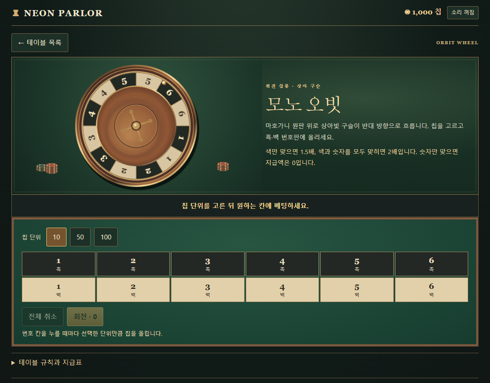

# Neon Parlor · 황동 살롱

[브라우저에서 바로 플레이](https://chsh3462-byte.github.io/play/neon-parlor/web/) · [모든 배포 파일](https://github.com/chsh3462-byte/play/releases/tag/neon-parlor-v2.0)

| 원하는 방식 | 받거나 실행할 파일 |
| --- | --- |
| 웹 링크로 플레이 | [게임 열기](https://chsh3462-byte.github.io/play/neon-parlor/web/) |
| 웹판을 내려받아 오프라인 플레이 | [NeonParlor-Web.zip](https://github.com/chsh3462-byte/play/releases/download/neon-parlor-v2.0/NeonParlor-Web.zip) 압축을 풀고 index.html 열기 |
| Python 파일 하나로 실행 | [NeonParlor.py](https://github.com/chsh3462-byte/play/releases/download/neon-parlor-v2.0/NeonParlor.py) 다운로드 후 `py NeonParlor.py` |
| Python 소스와 게임 파일을 따로 보기 | [NeonParlor-Python.zip](https://github.com/chsh3462-byte/play/releases/download/neon-parlor-v2.0/NeonParlor-Python.zip) 압축을 풀고 `py main.py` |
| Windows 게임 창에서 실행 | [NeonParlor.exe](https://github.com/chsh3462-byte/play/releases/download/neon-parlor-v2.0/NeonParlor.exe) 더블클릭. Windows x64, Edge WebView2 필요 |

같은 가상 칩으로 슬롯·흑백 룰렛·딜러 홀덤·블랙잭을 즐길 수 있습니다. 온라인 계정이나 DB는 사용하지 않습니다. Python판은 기본 브라우저로 로컬 파일을 열고, EXE판은 Python과 WebView2를 이용해 별도 창으로 실행합니다.

### 소스와 기록

- [웹 게임](web/) · [Python 실행기](python/) · [Windows 빌드](windows/)
- [버전별 업데이트](docs/CHANGELOG.md) · [기능 및 규칙](docs/FEATURES.md)
- [오류 재현 및 수정](docs/FIXES.md) · [검증 기록](docs/VERIFICATION.md) · [회귀 검사 코드](checks/verify.py)

